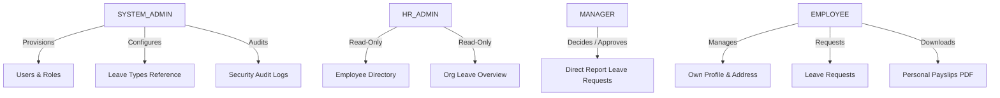
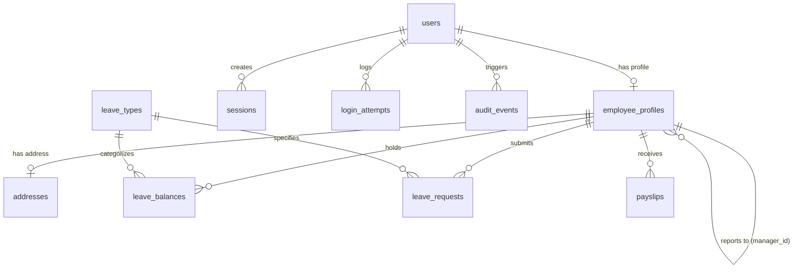

# Employee Self-Service (ESS) & Management Portal
## Comprehensive Enterprise System Documentation & Architecture Guide

---

### Table of Contents
1. [Executive Summary & System Overview](#1-executive-summary--system-overview)
2. [Visual Design System & Brand Identity](#2-visual-design-system--brand-identity)
3. [User Roles, Permissions & Separation of Duties](#3-user-roles-permissions--separation-of-duties)
4. [Functional Feature Specifications](#4-functional-feature-specifications)
   - [4.1 Public Landing Page & Interactive Platform Preview](#41-public-landing-page--interactive-platform-preview)
   - [4.2 Employee Dashboard & Fiscal Year Leave Sync](#42-employee-dashboard--fiscal-year-leave-sync)
   - [4.3 Leave Quota Lifecycle & Real-Time Balance Deductions](#43-leave-quota-lifecycle--real-time-balance-deductions)
   - [4.4 Profile & Address Management with Optimistic Locking](#44-profile--address-management-with-optimistic-locking)
   - [4.5 Digital Payslip Viewer & PDFKit Secure Downloads](#45-digital-payslip-viewer--pdfkit-secure-downloads)
   - [4.6 Manager Direct Report Approval Workflows](#46-manager-direct-report-approval-workflows)
   - [4.7 HR Administration (Directory & Leave Overview)](#47-hr-administration-directory--leave-overview)
   - [4.8 System Administration (User Provisioning, Manager Assignments, Reference Config, Audit Logs)](#48-system-administration-user-provisioning-manager-assignments-reference-config-audit-logs)
5. [Technical Architecture & Monorepo Structure](#5-technical-architecture--monorepo-structure)
6. [Database Schema, Integrity Constraints & Atomic RPC Functions](#6-database-schema-integrity-constraints--atomic-rpc-functions)
7. [Security Architecture & Threat Mitigation (OWASP Top 10)](#7-security-architecture--threat-mitigation-owasp-top-10)
8. [API Route Reference](#8-api-route-reference)
9. [Multi-Device Responsiveness & Touch Optimization](#9-multi-device-responsiveness--touch-optimization)
10. [Deployment & DevOps (Vercel & Supabase)](#10-deployment--devops-vercel--supabase)
11. [Automated Testing Suite](#11-automated-testing-suite)
12. [Troubleshooting & Maintenance FAQ](#12-troubleshooting--maintenance-faq)

---

## 1. Executive Summary & System Overview

The **Employee Self-Service (ESS) & Management Portal** is a production-grade, enterprise workplace application engineered for corporate workforce management, role-based workflows, and digital compliance. 

Designed following a zero-trust security paradigm, the platform decouples administrative oversight, managerial approval chains, and personal employee self-service while enforcing strict isolation through atomic PostgreSQL database transactions, optimistic concurrency locking, and secure session management.

### Key Highlights
- **Single Source of Truth**: All state is managed within Supabase (PostgreSQL 15), backed by atomic PL/pgSQL stored procedures (`rpc_*`) with rollback guarantees.
- **Enterprise Visual Identity**: Bold high-contrast palette (*Acid Lime, Charcoal, Vibrant Orange, Warm Ivory*) designed to deliver a modern SaaS impression across desktop and mobile.
- **Fiscal Year Leave Sync**: Annual leave quotas sync automatically directly from the database per calendar fiscal year (`Jan 1 – Dec 31`), recalculating available, used, and pending days in real time.
- **Automated Employee Provisioning**: Administrators can generate employee IDs sequentially (`EMP-XXXX`) or randomly with collision-free validation, assign direct managers, and dynamically reassign reporting managers.
- **Zero-Trust Security**: Deny-by-default Row-Level Security (RLS), single-origin CSRF validation, HttpOnly `__Host-` session cookies, constant-time token verification, and strict Content Security Policies (CSP).

---

## 2. Visual Design System & Brand Identity

The interface rejects bland, generic UI templates in favor of a curated, high-contrast visual identity:

### Color Palette Tokens
| Token | Hex Value | Semantic Application |
|---|---|---|
| **Primary Acid Lime** | `#D6F23A` | Primary actions, key callouts, active badges, progress bars |
| **Charcoal** | `#191C18` | Primary text, dark sidebars, dark card headers, active pills |
| **Vibrant Orange** | `#F47738` | Pending alerts, warning states, high-priority notifications |
| **Warm Ivory** | `#F5F3EC` | Global canvas background, sub-surface layouts |
| **Soft Lime** | `#E8EDCF` | Secondary buttons, subtle highlights, active navigation backgrounds |
| **Pure White** | `#FFFFFF` | Surface cards, modals, table backgrounds |
| **Border Tone** | `#E5E1D6` | Standard structural borders, card separators, table grid lines |
| **Muted Grey** | `#777A70` | Secondary descriptions, timestamps, metadata labels |

### Typography & Spacing
- **Primary Typeface**: `Inter` (Google Fonts), fallback to system sans-serif (`-apple-system, BlinkMacSystemFont, 'Segoe UI', Roboto`).
- **Monospace Typeface**: `JetBrains Mono` / `Menlo` for correlation IDs, masked bank accounts, PAN numbers, and employee codes.
- **Modular Spacing**: 4px / 8px grid system with strict padding constraints (`16px`, `20px`, `24px`, `32px`).
- **Corner Radii**: Consistent rounded geometry (`4px` for pills/tags, `6px` for inputs/buttons, `8px` for surface cards).

---

## 3. User Roles, Permissions & Separation of Duties

The portal strictly enforces the **Principle of Least Privilege (PoLP)** and **Separation of Duties (SoD)** across four distinct roles:



### Role Matrix Breakdown

| Capability / Resource | EMPLOYEE | MANAGER | HR_ADMIN | SYSTEM_ADMIN |
|---|:---:|:---:|:---:|:---:|
| View Overview Dashboard & Balances | ✅ (Self) | ✅ (Self) | ✅ (Self) | ❌ (Strict SoD) |
| Manage Residential/Mailing Address | ✅ (Self) | ✅ (Self) | ✅ (Self) | ✅ (Self) |
| Submit / Cancel Personal Leave Requests | ✅ (Self) | ✅ (Self) | ✅ (Self) | ❌ (Denied) |
| View & Download Personal PDF Payslips | ✅ (Self) | ✅ (Self) | ✅ (Self) | ❌ (Denied) |
| Decide Direct Report Leave Requests | ❌ | ✅ (Direct Reports Only) | ❌ | ❌ |
| View Company-Wide Employee Directory | ❌ | ❌ | ✅ (Read-Only) | ❌ |
| View Company-Wide Leave Overview | ❌ | ❌ | ✅ (Read-Only) | ❌ |
| Provision User Accounts & Assign Managers | ❌ | ❌ | ❌ | ✅ |
| Reassign Employee Reporting Manager | ❌ | ❌ | ❌ | ✅ |
| Configure Leave Types & Annual Quotas | ❌ | ❌ | ❌ | ✅ |
| View Immutable Security Audit Logs | ❌ | ❌ | ❌ | ✅ |

> [!IMPORTANT]
> **Separation of Duties Guardrail**: `SYSTEM_ADMIN` accounts are strictly forbidden from accessing personal payroll records (`/api/payslips*`) or personal leave requests (`/api/leaves*`). System Administrators exist purely to manage access, reference configuration, and security audits.

---

## 4. Functional Feature Specifications

### 4.1 Public Landing Page & Interactive Platform Preview
- **Two-Column Hero Gateway**: Left column features platform value propositions, real-time trust pills (*Role-Based Access, CSRF Protected, Row Level Security*), and CTA actions. Right column embeds the corporate login gateway.
- **Instant Demo Credentials**: Quick-fill buttons for all 4 roles (*Employee, Manager, HR Admin, System Admin*) allow one-click evaluation in development and deployment previews.
- **Section Walkthroughs**:
  - **Platform Preview**: Interactive tabbed environment previewing the Employee Dashboard, Manager Approval Portal, HR Directory, and System Admin Audit Console.
  - **Overview & Architecture**: Structural breakdown of data sovereignty, privacy controls, and audit trails.
  - **How It Works**: Visual three-step timeline (*Provision & Assign*, *Request & Real-Time Check*, *Decide & Audit Log*).
  - **Role Capabilities**: Interactive comparison table showing operational workflows for all four personas.
  - **Enterprise Security**: Detailed grid of encryption standards, optimistic concurrency locking, and zero-trust policies.

### 4.2 Employee Dashboard & Fiscal Year Leave Sync
- **Summary Metrics**: High-level counters for total available leave days across all categories, latest issued payslip net pay, and active residential address with optimistic version badge.
- **Leave Quotas & Balances Section**:
  - Synchronizes **directly with the database** for the current fiscal year.
  - Dynamically renders **all active leave categories** configured in the system (*Annual Privilege Leave, Medical & Sick Leave, Casual/Festival Leave, Parental Care Leave*, plus any custom administrative additions).
  - Displays **Available Days Remaining**, visual quota consumption progress bar, and exact counts for **Allocated Quota**, **Used Days**, and **Pending Approval Days**.
  - Verified live status badge: `Synced with DB · FY 2026`.

### 4.3 Leave Quota Lifecycle & Real-Time Balance Deductions
- **Fiscal Year Rule**: Quotas renew every calendar fiscal year (`Jan 1 – Dec 31`), **not** according to the employee's account creation anniversary.
- **Immediate Assignment on Creation**: When an admin provisions an employee, rows for all active leave types are immediately inserted into `leave_balances` for that calendar year with default annual quotas.
- **Self-Healing Auto-Provisioning**: If an existing employee queries balances for a new fiscal year (`2027`, `2028`, etc.) or if an admin configures a brand-new leave type, `getLeaveBalances` auto-creates missing rows in the database instantly.
- **Real-Time Deductions**:
  $$\text{Available Days} = \text{Allocated Days} - \text{Used Days} - \text{Pending Days}$$
  1. **Application**: Submitting a request locks the balance row via PostgreSQL `FOR UPDATE`, checks date ranges, checks for overlapping active requests, increments `pending_days`, and decreases `available_days`.
  2. **Approval**: When a manager approves, `pending_days` decrements and `used_days` increments.
  3. **Rejection / Cancellation**: Days are released back to available balance.

### 4.4 Profile & Address Management with Optimistic Locking
- **Masked PII Protection**: Sensitive employee fields (*Phone number, National ID, Tax PAN, Bank Account*) are masked server-side using secure SHA-256 transformations before transmission to the browser.
- **Optimistic Concurrency Control (OCC)**:
  - The `addresses` table enforces a `version` integer column.
  - Every update checks `WHERE id = p_address_id AND version = p_expected_version`.
  - If a concurrent session modified the record, a `409 Conflict` (`VERSION_CONFLICT`) is thrown, preventing lost updates.
- **Dual Address Synchronization**: Checkbox toggle allows mailing address to automatically mirror residential address.

### 4.5 Digital Payslip Viewer & PDFKit Secure Downloads
- **Payroll Registry**: Employees view issued pay slips sorted by period (`MM/YYYY`).
- **Dynamic PDF Generation**: Clicking "Download PDF" streams an on-the-fly generated, cryptographically signed corporate payslip rendered using `pdfkit`.
- **Anti-Caching Headers**: All download endpoints return `Cache-Control: no-store, no-cache, must-revalidate, private` to prevent sensitive payroll data from lingering in shared browser caches or CDNs.

### 4.6 Manager Direct Report Approval Workflows
- **Manager-Employee Relationship Check**: Enforces that managers can **only** inspect and decide leave requests submitted by employees whose `manager_id` matches the authenticated manager's profile ID.
- **Atomic Decision RPC**: Approvals and rejections execute through `rpc_decide_leave_request`, updating request status, modifying `leave_balances`, incrementing record version, and creating an immutable audit event in a single transaction.

### 4.7 HR Administration (Directory & Leave Overview)
- **Employee Directory**: Searchable, paginated company directory with department filters, employment status indicators, and masked contact info.
- **Organization Leave Overview**: Read-only oversight of all leave requests across every department with date range filtering and manager decision status.

### 4.8 System Administration
- **Automated Sequential & Random Employee ID Generation**:
  - Automatically calculates the next sequential code (`EMP-XXXX`) from existing database records on page load and immediately following user creation.
  - Features quick-toggle buttons:
    - **`Sequential`**: Selects highest existing ID + 1.
    - **`Random`**: Generates a random, unused 4-digit code between `1000` and `9999` with collision verification.
- **Manager Assignment & Dynamic Reassignment**:
  - **Account Creation**: Dropdown populated with all active `MANAGER` profiles allows assigning an initial supervisor.
  - **Live Reassignment**: Dedicated "Change Manager" action modal allows updating an employee's supervisor at any time without recreating their account or invalidating history.
- **Leave Types Reference Configuration**: System Admins configure organization-wide leave codes, display names, policy descriptions, and default annual quotas.
- **Security Audit Event Log**: Immutable ledger of all system operations (*login failures, lockouts, address updates, leave approvals, user provisioning*) with correlation IDs, client IPs, actor user IDs, and before/after metadata.

---

## 5. Technical Architecture & Monorepo Structure

```
employee-self-service-portal/
├── api/
│   └── index.js             # Vercel Serverless Function entry point
├── client/                  # Frontend Single Page Application (React 18 + Vite)
│   ├── src/
│   │   ├── api/client.js    # Fetch client with in-memory CSRF & cookie credentials
│   │   ├── components/      # Reusable AppShell, LoginForm, Dialogs, Badges
│   │   ├── context/         # AuthContext (session state, RBAC routing)
│   │   ├── pages/           # Landing, Dashboard, Leaves, Payslips, Profile, Admin, HR
│   │   └── styles/          # index.css (design tokens), landing.css
│   ├── index.html           # HTML5 entry with Inter Google Font preconnect
│   └── vite.config.js       # Vite dev proxy configuration
├── server/                  # Backend REST API (Node.js + Express 4)
│   ├── src/
│   │   ├── app.js           # Express app factory & route bindings
│   │   ├── config/          # Environment loader & startup validation
│   │   ├── controllers/     # HTTP controllers with correlation tracking
│   │   ├── middleware/      # Security, CORS, CSRF, Rate Limiting, RBAC
│   │   ├── repositories/    # Database adapter (Supabase live + Memory test)
│   │   ├── services/        # Business logic, optimistic locking, password hashing
│   │   ├── utils/           # Crypto, PDF generator, structured logger, errors
│   │   └── validators/      # Zod schema definitions
│   └── tests/               # Automated unit, security & API test suite
├── supabase/                # PostgreSQL DDL & Stored Procedures
│   ├── 01_schema.sql        # Database tables, RLS policies, indexes, RPCs
│   ├── 02_seed.sql          # Seed enterprise dataset (10 employees, 4 leave types)
│   └── 99_reset.sql         # Clean database teardown script
├── vercel.json              # Vercel deployment routing & SPA fallbacks
└── package.json             # Root monorepo workspace configuration
```

---

## 6. Database Schema, Integrity Constraints & Atomic RPC Functions



### Table Definitions & Primary Constraints

1. **`users`**: Central authentication accounts.
   - Unique email constraint (`uq_users_email`).
   - Role constraint: `ROLE IN ('EMPLOYEE', 'MANAGER', 'HR_ADMIN', 'SYSTEM_ADMIN')`.
   - Status constraint: `STATUS IN ('ACTIVE', 'LOCKED', 'SUSPENDED')`.
   - Failed login tracking: `failed_login_count`, `locked_until`.
2. **`employee_profiles`**: Core employee demographics.
   - Unique employee code constraint: `chk_employee_code_format CHECK (employee_code ~ '^EMP-[0-9]{4}$')`.
   - Manager hierarchy check: `chk_employee_no_self_manager CHECK (manager_id IS NULL OR manager_id <> id)`.
3. **`addresses`**: Residential and mailing coordinates.
   - Unique constraint: `UNIQUE (employee_id)` (1-to-1).
   - Optimistic lock version: `version INTEGER NOT NULL DEFAULT 1`.
4. **`leave_types`**: Configurable organizational categories.
   - Quota limit: `default_annual_quota BETWEEN 1 AND 365`.
   - Unique code constraint (`uq_leave_types_code`).
5. **`leave_balances`**: Per-employee annual leave entitlements.
   - Unique composite constraint: `UNIQUE (employee_id, leave_type_id, year)`.
   - Optimistic lock version: `version INTEGER NOT NULL DEFAULT 1`.
   - Non-negative invariant: `allocated_days >= 0 AND used_days >= 0 AND pending_days >= 0`.
6. **`leave_requests`**: Employee leave submissions.
   - Status: `status IN ('PENDING', 'APPROVED', 'REJECTED', 'CANCELLED')`.
   - Date validation: `end_date >= start_date`.
   - Overlap exclusion constraint: prevents overlapping active leave requests for the same employee.
7. **`payslips`**: Immutable payroll earnings statements.
   - Net pay invariant: `net_pay = gross_pay - total_deductions`.
8. **`sessions`**: Server-side revocable session storage.
   - Hash lookup: `token_hash CHAR(64) UNIQUE`.
9. **`login_attempts`**: IP and email lockout registry.
10. **`audit_events`**: Immutable append-only enterprise security audit log.

### Stored PL/pgSQL Atomic Procedures (RPCs)
- **`rpc_create_leave_request`**: Checks idempotency, locks balance row with `FOR UPDATE`, validates available quota, prevents date overlaps, increments `pending_days`, writes request, and logs audit event atomically.
- **`rpc_decide_leave_request`**: Verifies manager relationship, locks balance, transitions days from `pending_days` to `used_days` (on approval) or releases `pending_days` (on rejection), and updates request state.
- **`rpc_cancel_leave_request`**: Allows an employee to cancel a `PENDING` (or upcoming `APPROVED`) request, restoring quota days.
- **`rpc_update_employee_address`**: Validates `expected_version`, executes atomic update, increments `version + 1`, and logs before/after metadata.

---

## 7. Security Architecture & Threat Mitigation (OWASP Top 10)

| Vulnerability Threat | Enterprise Mitigation Implemented |
|---|---|
| **SQL / NoSQL Injection** | Parameterized queries exclusively via Supabase SDK; strict Zod schema validation on all inputs; explicit regex checks on path params. |
| **Broken Object-Level Auth (BOLA / IDOR)** | Endpoints resolve the active employee record from `req.auth.employee.id` (derived from the validated session cookie). Employees cannot query or modify another employee's records. |
| **Broken Function-Level Auth (BFLA)** | Centralized `createAuthorizePolicy` middleware checks role against required whitelist. Non-managers calling `/api/leaves/team` receive `403 Forbidden`. |
| **Cross-Site Request Forgery (CSRF)** | Per-session CSRF token stored in server-side session; verified on all state-changing verbs (`POST`, `PATCH`, `PUT`, `DELETE`) via constant-time string comparison (`timingSafeEqual`). |
| **Session Hijacking & XSS** | Session tokens stored exclusively in `HttpOnly`, `Secure`, `SameSite=Strict`, `__Host-` prefixed cookies. In-memory CSRF token; strict Content Security Policy (CSP) blocking external scripts and object embeddings. |
| **Brute Force & Credential Stuffing** | Dual rate limiting: IP-based sliding window (`15 attempts / 15 min`) + Account lockout after 5 consecutive failed logins (`locked_until = now + 15 min`). Generic error messages prevent user enumeration. |
| **Data Leakage in URLs** | `forbidTokensInUrlMiddleware` immediately rejects any incoming request containing `token`, `session`, `password`, or `secret` in query parameters. |
| **Sensitive Data Exposure** | Password hashes use BCrypt (work factor 12); PII (National ID, Tax PAN, Bank Account, Phone) is masked with asterisks; API returns `Cache-Control: no-store` on all endpoints. |

---

## 8. API Route Reference

### Authentication & Sessions
- `POST /api/auth/login`: Authenticate with work email & password; sets HttpOnly cookie and returns CSRF token.
- `POST /api/auth/logout`: Revokes session in database, clears cookie, logs audit event.
- `GET /api/auth/session`: Validates current session token and returns active user role and profile.

### Employee Self-Service
- `GET /api/employees/me`: Retrieves authenticated employee profile and current address.
- `PATCH /api/employees/me/address`: Updates residential/mailing address with optimistic lock version.

### Leave Management
- `GET /api/leaves/balance?year=2026`: Fetches all synced leave categories, quotas, used days, and available days.
- `POST /api/leaves`: Submits a new leave request (idempotent, atomic balance deduction).
- `GET /api/leaves/my`: Lists own paginated leave requests with status filtering.
- `POST /api/leaves/:id/cancel`: Cancels own pending leave request.

### Payroll & Payslips
- `GET /api/payslips`: Lists own issued payslips by year/month.
- `GET /api/payslips/:id/download`: Streams secure on-the-fly generated PDF payslip.

### Manager Approvals
- `GET /api/leaves/team`: Lists leave requests belonging exclusively to direct reports.
- `POST /api/leaves/:id/decision`: Approves or rejects a direct report's leave request with review comments.

### HR Administration
- `GET /api/hr/employees`: Lists company-wide directory with department and status filters.
- `GET /api/hr/leaves`: Company-wide read-only leave overview across all departments.

### System Administration
- `GET /api/admin/users`: Lists all user accounts with profile details and assigned managers.
- `GET /api/admin/managers`: Returns all active managers available for supervisor assignment.
- `POST /api/admin/users`: Provisions a new user account, creates profile, assigns manager, and initializes fiscal year balances.
- `PATCH /api/admin/users/:id`: Updates account status (`ACTIVE` / `LOCKED`) or reassigns employee's reporting manager.
- `GET /api/admin/leave-types`: Lists reference leave type configurations.
- `POST /api/admin/leave-types`: Adds a new organization leave type and annual quota.
- `GET /api/admin/audit-events`: Queries immutable security audit event ledger.

---

## 9. Multi-Device Responsiveness & Touch Optimization

The portal provides first-class support for **Mobile Phones (320px – 640px)**, **Tablets (641px – 1024px)**, and **Desktops (1024px+)**:

1. **Off-Canvas Mobile Drawer**:
   - On screens `<= 1024px`, the primary navigation sidebar transforms into an off-canvas drawer.
   - Activated via topbar hamburger toggle (`<Menu size={20} />`) with smooth transition and backdrop blur.
   - Automatically closes when any navigation link is clicked or when route changes.
2. **Horizontal Table Momentum Scrolling**:
   - Data tables are enclosed in touch-scrollable wrappers (`-webkit-overflow-scrolling: touch`) with `min-width: 600px`, preventing column squishing.
3. **iOS Safari Auto-Zoom Prevention**:
   - All text inputs, selects, and textareas enforce `font-size: 16px` on mobile viewports, preventing iOS from auto-zooming on focus.
4. **Touch Target Sizing**:
   - All interactive buttons and inputs adhere to Apple and Material Design guidelines with a minimum touch height of `44px`.
5. **Fluid Grid Layouts**:
   - `.grid-4`: 4 columns on desktop $\rightarrow$ 2 columns on tablet $\rightarrow$ 1 column on phone.
   - `.grid-3`: 3 columns on desktop $\rightarrow$ 2 columns on tablet $\rightarrow$ 1 column on phone.
   - `.grid-2`: 2 columns on desktop $\rightarrow$ 1 column on phone.

---

## 10. Deployment & DevOps (Vercel & Supabase)

### Production Deployment on Vercel
The repository includes pre-configured Vercel configuration files:
- **`vercel.json`**: Directs static assets to `client/dist` and routes `/api/*` to `/api/index.js`.
- **`api/index.js`**: Serverless function entry point executing the Express API in serverless environments.

#### Environment Variables Checklist
Configure these in **Vercel Dashboard $\rightarrow$ Project Settings $\rightarrow$ Environment Variables**:
| Variable Name | Required | Example / Description |
|---|:---:|---|
| `SUPABASE_URL` | **Yes** | `https://your-project-id.supabase.co` |
| `SUPABASE_SERVICE_ROLE_KEY` | **Yes** | Secret service role key (bypasses RLS for API operations) |
| `NODE_ENV` | **Yes** | `production` |
| `CLIENT_ORIGIN` | Optional | `https://your-domain.vercel.app` (Defaults to same-origin) |

#### Local Development Run
```powershell
# Install all dependencies across root, server, and client
npm install

# Run Vite frontend (localhost:5173) and Express backend (localhost:4000) concurrently
npm run dev
```

---

## 11. Automated Testing Suite

The codebase includes an automated test harness covering API contracts, transactional RPC behaviors, and negative security testing:

```powershell
# Run the complete test suite
node --test server/tests/api.test.js server/tests/security.test.js
```

### Verified Acceptance Criteria (AC-01 through AC-05)
- **AC-01**: Employee address updates, optimistic version increments, and audit log generation.
- **AC-02**: Cross-employee authorization barriers (BOLA/IDOR prevention).
- **AC-03**: Atomic leave request creation, balance locking, and date overlap exclusion.
- **AC-04**: Direct manager leave decisions and atomic balance state transitions.
- **AC-05**: Dynamic PDF payslip streaming with no-store cache headers.

### Verified Security Controls
- Authentication bypass rejection (401).
- Weak password rejection & user enumeration protection.
- Session fixation, idle timeout expiry & logout revocation.
- Vertical role escalation barriers (BFLA).
- Manager hierarchy violation checks.
- SQL injection / XSS payload neutralization.
- Double-submit CSRF token enforcement (403).
- Consecutive failed login account lockout & IP rate limiting (429).

---

## 12. Troubleshooting & Maintenance FAQ

**Q: Why does the API return `CONFIGURATION ERROR` on server startup?**  
A: `SUPABASE_URL` or `SUPABASE_SERVICE_ROLE_KEY` is missing. Ensure both values are filled in `server/.env` (locally) or in Vercel's Environment Variables (in production).

**Q: Why do newly created employees show active leave quotas on their dashboard?**  
A: `createAdminUser` automatically seeds all active leave types for the active fiscal year into `leave_balances`. Additionally, `getLeaveBalances` auto-provisions missing rows if called for a new fiscal year.

**Q: Can a System Administrator view employee payslips or submit leave requests?**  
A: No. In accordance with strict Separation of Duties (SoD), System Admins receive `403 Forbidden` on payroll and leave endpoints. They only manage accounts, reference types, and audit logs.

**Q: How does sequential vs random employee ID generation work?**  
A: The admin user provisioning form inspects all existing `EMP-XXXX` codes, identifies the maximum numeric suffix, and auto-fills the next sequential ID. The admin can click **`Random`** at any time to generate an unused random 4-digit code.
