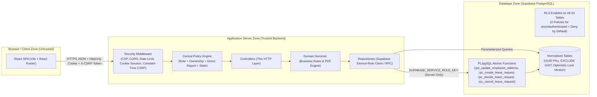
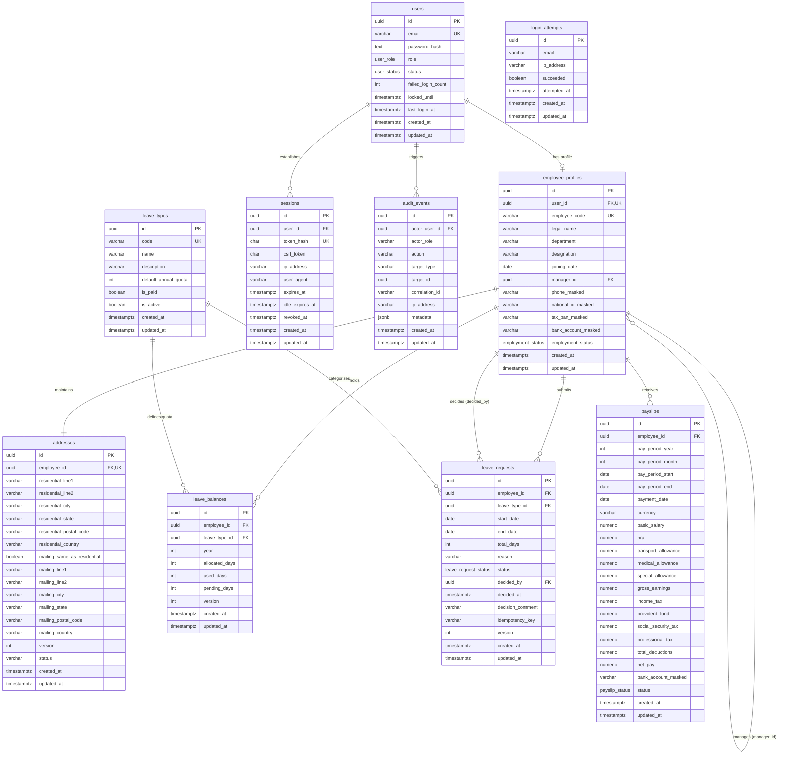

# Architecture & Design Decisions (`docs/ARCHITECTURE.md`)

## 1. System Context & Trust Boundaries

The Employee Self-Service Portal is a layered, security-first web application built with a React (Vite) single-page frontend, a Node.js + Express REST API backend, and a Supabase (PostgreSQL) relational database.

### Trust Boundary Diagram

### Trust Boundaries
1. **Browser -> Node API Boundary**: All input from the browser (`req.body`, `req.query`, `req.params`, headers, cookies) is treated as untrusted. The browser never communicates with Supabase directly and never receives any Supabase URL or key.
2. **Authentication & CSRF Boundary**: Every protected request must present a valid 256-bit opaque session token inside an `HttpOnly`, `SameSite=Strict` cookie (`ess_session` in development, `__Host-ess_session` in production). State-changing requests (`POST`, `PATCH`, `PUT`, `DELETE`) must additionally supply the session's `X-CSRF-Token` header, verified using `crypto.timingSafeEqual`.
3. **Authorization Policy Boundary**: Every route passes through the centralized `authorize` middleware (`server/src/middleware/security.js`), which verifies role membership, separation of duties, resource ownership, manager-to-direct-report hierarchy, and workflow state before executing business logic.
4. **Node API -> Supabase PostgreSQL Boundary**: The Node API connects using `SUPABASE_SERVICE_ROLE_KEY` stored exclusively in `server/.env`. Every table has Row Level Security (RLS) enabled with **zero policies** for `anon` and `authenticated` roles, plus `REVOKE ALL ON ALL TABLES IN SCHEMA public FROM anon, authenticated`. Even if a project's anon key were leaked, zero rows could be read or modified through Supabase's public PostgREST interface.

## 2. Layered Backend Architecture

The backend (`server/src/`) strictly separates responsibilities across four layers:
- **Routes (`src/app.js`, `src/routes/openapi.js`)**: Binds HTTP verbs and paths to rate limiters, authentication, CSRF verification, central `authorize` policies, and controller actions.
- **Controllers (`src/controllers/index.js`)**: Thin HTTP adapters that invoke strict validators (`src/validators/schemas.js`), pass validated DTOs to services, and format HTTP status codes and headers.
- **Services (`src/services/index.js`)**: Encapsulates domain rules, equal-time password verification, account lockout backoff, on-demand PDF generation (`src/utils/pdf.js`), and audit event orchestration.
- **Repositories (`src/repositories/db.js`)**: Encapsulates all database queries and `supabase.rpc()` calls. Never concatenates SQL strings.

## 3. Six Mandatory Architecture Decisions

### Decision 1: Zero Browser-to-Supabase Communication
- **Context**: Exposing Supabase client credentials to the browser shifts security enforcement to client-visible RLS rules and risks leaking service details.
- **Decision**: Only the Node API talks to Supabase using `SUPABASE_SERVICE_ROLE_KEY` in `server/.env`. The React client only knows `VITE_API_BASE_URL` (proxied via `/api` in development).

### Decision 2: Defense-in-Depth Row Level Security (Deny by Default)
- **Context**: Supabase exposes PostgREST endpoints by default on the `public` schema.
- **Decision**: `supabase/01_schema.sql` executes `ALTER TABLE ... ENABLE ROW LEVEL SECURITY` on all 10 tables without creating any policies for `anon` or `authenticated`, and revokes all privileges from those roles. Because the Node backend uses the `service_role` key, it bypasses RLS while all external direct access is completely blocked.

### Decision 3: Server-Side Opaque Sessions with SHA-256 Hashing & Constant-Time CSRF (No JWT Secret in `.env`)
- **Context**: Stateless JWTs cannot be cleanly revoked on logout without a backing store and require managing signing secrets in `.env`.
- **Decision**:
  - Passwords are hashed with bcrypt cost 12 (`$2a$12$`) and require a minimum of 12 characters.
  - On login, the server generates a cryptographically random 256-bit (64 hex char) opaque session token (`rawToken`) and a 256-bit `csrfToken`.
  - Only `SHA-256(rawToken)` is stored in `sessions.token_hash`, along with `expires_at` (8 hours), `idle_expires_at` (30 minutes sliding), and `revoked_at`.
  - Because the session token is high-entropy random bytes and stored hashed, **no session secret or JWT secret is required in `.env`**. Only `SUPABASE_URL` and `SUPABASE_SERVICE_ROLE_KEY` are needed.

### Decision 4: Atomic Multi-Step Business Operations via PL/pgSQL `rpc()`
- **Context**: `@supabase/supabase-js` operates over HTTP and does not support multi-statement client-side transactions (`BEGIN ... COMMIT`).
- **Decision**: Every multi-step business workflow is implemented as a transactional `SECURITY DEFINER` PL/pgSQL function in `supabase/01_schema.sql` and invoked via `supabase.rpc()`:
  - `rpc_update_employee_address`: Locks the `addresses` row (`FOR UPDATE`), verifies the optimistic lock `version`, updates the address, increments `version`, and inserts a `before`/`after` audit event in a single atomic transaction.
  - `rpc_create_leave_request`: Checks idempotency key, locks the `leave_balances` row (`FOR UPDATE`), verifies available days (`allocated - used - pending >= requested`), checks for overlapping active requests, increments `pending_days`, inserts the `leave_requests` row, and logs an audit event atomically.
  - `rpc_decide_leave_request`: Locks the `leave_requests` and `leave_balances` rows, verifies the manager's direct-report relationship and `PENDING` status, checks optimistic lock `version`, transitions status to `APPROVED` (moving `pending_days` to `used_days`) or `REJECTED` (releasing `pending_days`), and records an audit event atomically.
  - `rpc_cancel_leave_request`: Atomically verifies ownership and `PENDING` status, transitions status to `CANCELLED`, restores `pending_days`, and writes an audit event.

### Decision 5: On-Demand Server-Side Payslip PDF Streaming
- **Context**: Storing generated payslip PDFs in object storage buckets introduces risks of misconfigured public ACLs, predictable URLs, or stale cached files.
- **Decision**: Payslips are stored as normalized financial rows in the `payslips` table (`gross_earnings`, `total_deductions`, `net_pay` verified by SQL `CHECK` constraints). When `GET /api/payslips/:id/download` is called, the server verifies ownership (`payslip.employee_id === req.auth.employee.id`), renders the PDF binary in memory (`server/src/utils/pdf.js`), records a `PAYSLIP_DOWNLOADED` audit event, and streams the buffer with `Content-Type: application/pdf`, `Content-Disposition: attachment; filename="Payslip_EMP-XXXX_YYYY_MM.pdf"`, and `Cache-Control: no-store, private`.

### Decision 6: UUID Primary Keys, Optimistic Locking, and Timezone Policy
- **Context**: Sequential integer IDs make BOLA enumeration trivial, and concurrent edits can silently overwrite records.
- **Decision**:
  - Every table uses UUIDv4 primary keys (`gen_random_uuid()`), paired with strict backend ownership/relationship checks.
  - `addresses`, `leave_requests`, and `leave_balances` include an integer `version` column for optimistic locking; stale updates fail with `409 Conflict`.
  - **Timezone Policy**: All timestamps (`created_at`, `updated_at`, `expires_at`, `idle_expires_at`, `decided_at`, `attempted_at`) are stored in UTC (`TIMESTAMPTZ`) in PostgreSQL and formatted in the user's locale in the React UI (e.g., `10 Aug 2026`).

## 4. Entity-Relationship (ER) Diagram

